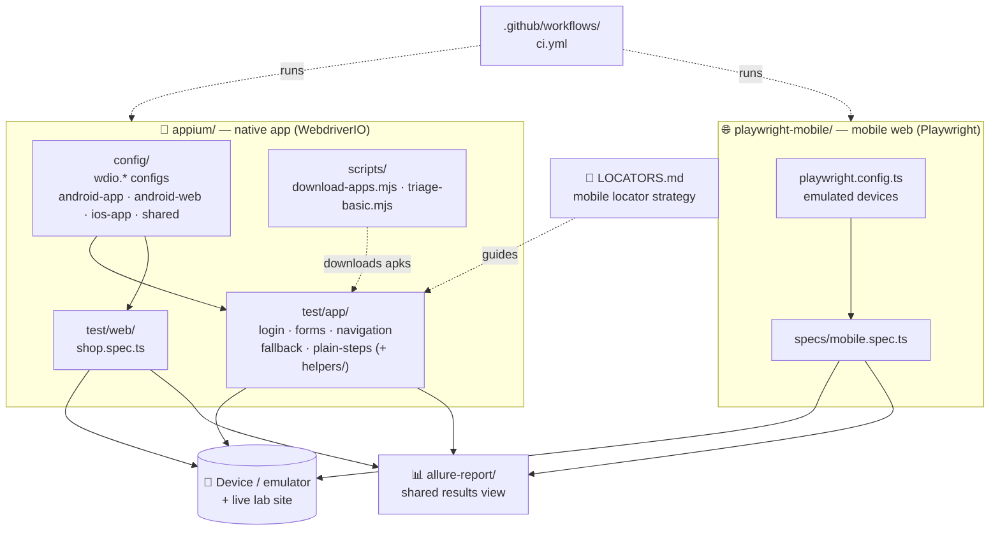

# Architecture

How this repo's folders fit together. It holds **two independent sub-projects**, each with its own `package.json` and `node_modules`:

- **`appium/`** — native Android + iOS app testing with WebdriverIO, including self-healing locators and a triage sample.
- **`playwright-mobile/`** — the same site tested as mobile web via Playwright's device emulation.

Pick the project for the platform you're testing; they don't share code. CI runs both.

## Every folder, top to bottom

| Folder / file | What it is | Why it's here |
|---|---|---|
| `appium/` | The native-app project (its own `package.json`). | Everything for driving the real app on Android/iOS. |
| `appium/config/` | WebdriverIO configs: `wdio.android.app`, `wdio.android.web`, `wdio.ios.app`, `wdio.shared`. | One config per platform/target; `shared` holds the common capabilities. |
| `appium/scripts/` | `download-apps.mjs` (fetch the app binaries), `triage-basic.mjs` (sort failures). | Setup and the failure-triage sample. Run via `npm run apps` / `npm run triage`. |
| `appium/test/app/` | Native specs: `login`, `forms`, `navigation`, `fallback`, `plain-steps`, plus `helpers/` (`fallback.ts`, `locators.ts`, `plain-steps.ts`). | The native app tests and their reusable locator/self-healing helpers. |
| `appium/test/web/` | `shop.spec.ts`. | Mobile-web check run through the Appium driver. |
| `playwright-mobile/` | The mobile-web project (its own `package.json`). | Tests the site under Playwright's device emulation. |
| `playwright-mobile/specs/` | `mobile.spec.ts`. | The emulated-device test(s). Run with `npm test`. |
| `playwright-mobile/playwright.config.ts` | Emulated device profiles, base URL, reporters. | How the mobile-web suite runs. |
| `LOCATORS.md` | Written guide to the mobile locator strategy. | Reference for how locators (and fallbacks) are chosen on mobile. |
| `.github/workflows/` | `ci.yml`. | Runs both sub-projects in CI. |

> **Two projects, run `npm install` in each.** `allure-results/` / `allure-report/` and downloaded app binaries are generated and git-ignored. The folders you *edit* are `appium/config/`, `appium/scripts/`, `appium/test/` and `playwright-mobile/specs/`.
